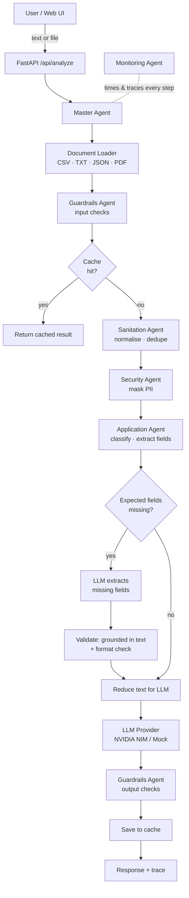
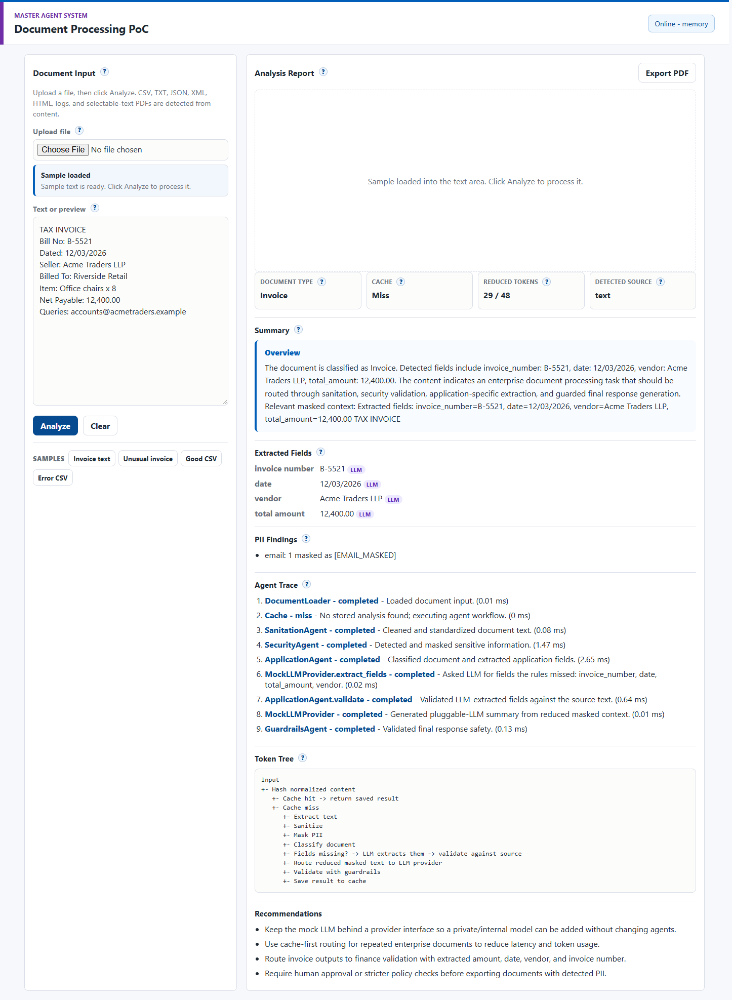
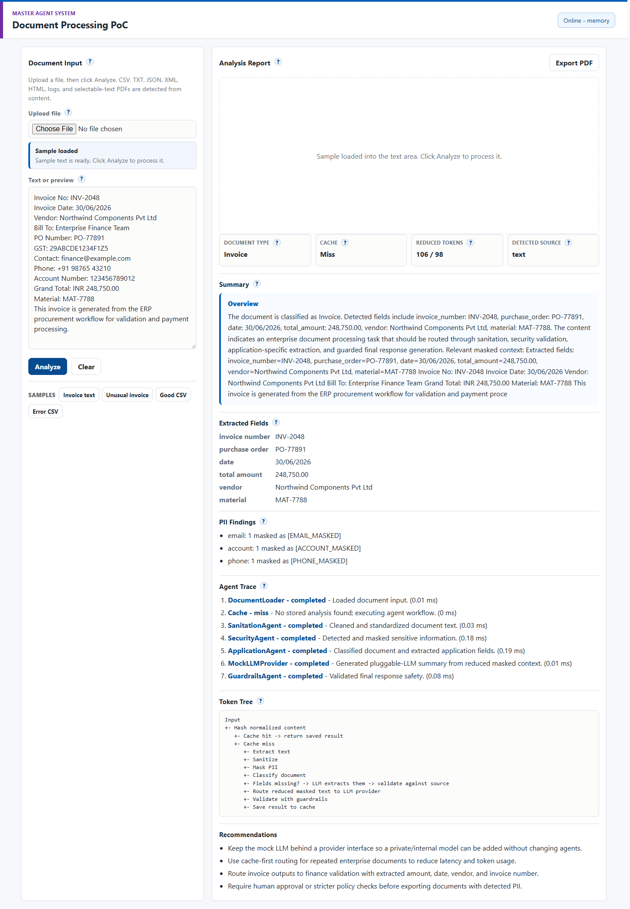

# 🤖 Multi-Agent Document Processor


A **master / sub-agent** system that processes enterprise documents (invoices,
ERP exports, CSVs, PDFs, plain text) **safely and cheaply** before an LLM ever
sees them.

A **Master Agent** orchestrates five specialised sub-agents. Together they
clean the input, **mask PII**, classify the document, extract key fields and
**shrink the text before it reaches the LLM**. They also run guardrail checks
on both the input and the output. When the rules can't find a field, an
**LLM extraction fallback** recovers it, and nothing the LLM returns is accepted
unless it's grounded in the document. Results are cached, so a repeated document
costs zero LLM calls.

---

## ✨ Features

| | |
|---|---|
| 🧭 **Master–agent orchestration** | One coordinator routes work through specialised, independently testable agents |
| 🔒 **PII masking** | Emails, phone numbers, Aadhaar, PAN and bank account numbers are masked *before* any LLM call |
| 🗂️ **Document classification** | Invoice, ERP, Invoice/ERP dataset, tabular dataset or general document, with a confidence score |
| 🧠 **LLM extraction fallback** | Fields the regex rules miss are extracted by the LLM, then validated: the value must appear verbatim in the document and pass a format check, otherwise it's rejected |
| ✂️ **Token reduction** | Only the relevant masked lines plus extracted fields go to the LLM; the original and reduced token counts are both reported |
| 🛡️ **Guardrails** | Size limits and prompt-injection detection on input; leaked-PII checks on output |
| ⚡ **Cache-first routing** | Content-hash cache (in-memory or Redis): a repeated document returns instantly |
| 🔌 **Pluggable LLM** | NVIDIA NIM out of the box, with automatic fallback to a mock provider, so it runs offline with no API key |
| 📊 **Observability** | A per-agent execution trace with timings, warnings and metrics |
| 🖥️ **Web UI** | Upload or paste a document, inspect every stage, export the report as PDF |

---

## 🏗️ Architecture



| Agent | Responsibility |
|---|---|
| **Master** | Orchestrates the pipeline, handles cache-first routing, assembles the final response and metrics |
| **Sanitation** | Normalises whitespace and line endings, removes duplicate lines |
| **Security** | Regex-based detection and masking of PII |
| **Application** | Classifies the document type and extracts fields (invoice no., amount, vendor, PO, material…); profiles CSV data; validates LLM-extracted fields |
| **Guardrails** | Blocks oversized and prompt-injection input; flags unmasked PII in the output |
| **Monitoring** | Times every step and collects the trace and warnings |

---

## 🧠 LLM extraction fallback

Regex rules are fast, free and predictable, but they only know the labels they were written for.
A bill that says `Bill No:` / `Seller:` / `Net Payable:` instead of `Invoice No:` / `Vendor:` / `Grand Total:` slips past them.

1. The Application Agent compares the extracted fields with what the document type should have
   (Invoice → invoice number, date, total, vendor; ERP → PO, material, vendor).
2. **Only the missing fields** are requested from the LLM, using the already-masked text (temperature 0, JSON-only reply).
3. Every value is **validated before it's accepted**:
   - it must appear **verbatim in the document**, so made-up values are rejected
   - it must not contain a masked placeholder such as `[EMAIL_MASKED]`
   - it must pass a **format check**: IDs contain digits, amounts are positive numbers, dates are real calendar dates
4. Accepted fields are tagged `"llm"` in `field_sources` and marked in the UI. Rejected ones show up as warnings and in `metrics.llm_fields_rejected`.

If the rules already found everything, the LLM isn't called at all.



> Without an API key, the mock provider simulates this step with a small set of label synonyms, so it can be demoed offline (**Unusual invoice** sample in the UI).

---

## 📁 Project structure

```
├── backend/
│   ├── requirements.txt
│   └── app/
│       ├── main.py                 # FastAPI app + static frontend serving
│       ├── schemas.py              # Pydantic response models
│       ├── agents/
│       │   ├── master/             # Orchestrator
│       │   ├── sanitation/
│       │   ├── security/
│       │   ├── application/
│       │   ├── guardrails/
│       │   └── monitoring/
│       └── core/
│           ├── cache.py            # In-memory / Redis cache
│           ├── document_loader.py  # Text, CSV, PDF extraction
│           └── llm_provider.py     # LLMProvider protocol, NVIDIA NIM, Mock
├── frontend/                       # Vanilla HTML/CSS/JS UI
├── samples/                        # Clean + error-laden invoice/ERP CSVs
├── tests/                          # Agent + API tests
└── docs/                           # Design documentation (PDF)
```

---

## 🚀 Quick start

```bash
git clone https://github.com/suryanshranjan/multi-agent-document-processor.git
cd multi-agent-document-processor

python -m venv venv
# Windows: venv\Scripts\activate    macOS/Linux: source venv/bin/activate
pip install -r backend/requirements.txt

python -m uvicorn backend.app.main:app --reload --port 8000
```

Open **http://127.0.0.1:8000**. The backend serves the UI too.



It works immediately with the **mock LLM provider**, so no API key is needed.

### Use a real LLM (NVIDIA NIM)

```bash
cp .env.example .env     # Windows: copy .env.example .env
```

Then set `NVIDIA_NIM_API_KEY` in `.env` and restart the server.
If NIM is unreachable during a request, the app falls back to the mock provider instead of failing.

| Variable | Default | Purpose |
|---|---|---|
| `NVIDIA_NIM_API_KEY` | *(unset → mock)* | Enables the NVIDIA NIM provider |
| `NVIDIA_NIM_MODEL` | `meta/llama-3.1-8b-instruct` | Model name |
| `NVIDIA_NIM_BASE_URL` | `https://integrate.api.nvidia.com/v1` | OpenAI-compatible endpoint |
| `REDIS_URL` | *(unset → in-memory)* | e.g. `redis://localhost:6379/0` |

> `.env` is in `.gitignore`, so your keys never get committed.

### Run the frontend separately (optional)

```bash
python -m http.server 5173 --directory frontend
```

Open http://127.0.0.1:5173. The UI calls the backend on port 8000 automatically.

---

## 🔌 API

| Method | Endpoint | Description |
|---|---|---|
| `GET` | `/api/health` | Service status and active cache backend |
| `GET` | `/api/cache/stats` | Cache hits, misses and entry count |
| `POST` | `/api/analyze` | Analyse a document (JSON `{"text": ...}` or multipart `text` + `file`) |
| `GET` | `/docs` | Interactive Swagger UI |

```bash
curl -X POST http://127.0.0.1:8000/api/analyze \
  -H "Content-Type: application/json" \
  -d '{"text": "Tax Invoice No: INV-1042\nGrand Total: 45,000\nContact: billing@acme.com\nVendor: Acme Ltd"}'
```

The response includes `document_type`, `summary`, `extracted_fields`, `field_sources` (`rules` or `llm` per field), `pii_findings`,
`masked_text_preview`, a per-agent `trace`, `warnings`, `recommendations`, and
`metrics` (original vs reduced token estimates, confidence, cache hit or miss).

---

## 🎬 Demo flow

1. Upload `samples/good_invoice_erp_sample.csv`, or paste invoice text.
2. Click **Analyze**. The result is a cache **miss**, and the full agent trace is shown.
3. Review the classification, masked PII, extracted fields and the token reduction.
4. Analyze the same input again. This time it's a cache **hit**, returned instantly with no LLM call.
5. Click the **Unusual invoice** sample. The rules miss every field, the LLM fallback recovers them, and each one is tagged **LLM**.
6. Try `samples/error_invoice_erp_sample.csv` to see the `data_quality_flags`: missing values, duplicates, bad dates and negative amounts.
7. Export the report with the **PDF** button.

---

## 🧪 Tests

```bash
python -m pytest -q
```

GitHub Actions runs the test suite on every push.

---

## 🛣️ Roadmap

- More private/internal LLM providers behind the `LLMProvider` protocol
- OCR for scanned PDFs
- RAG / vector-store support for document Q&A
- Human-in-the-loop approval for documents containing PII
- Domain agents for finance, procurement, HR and compliance
